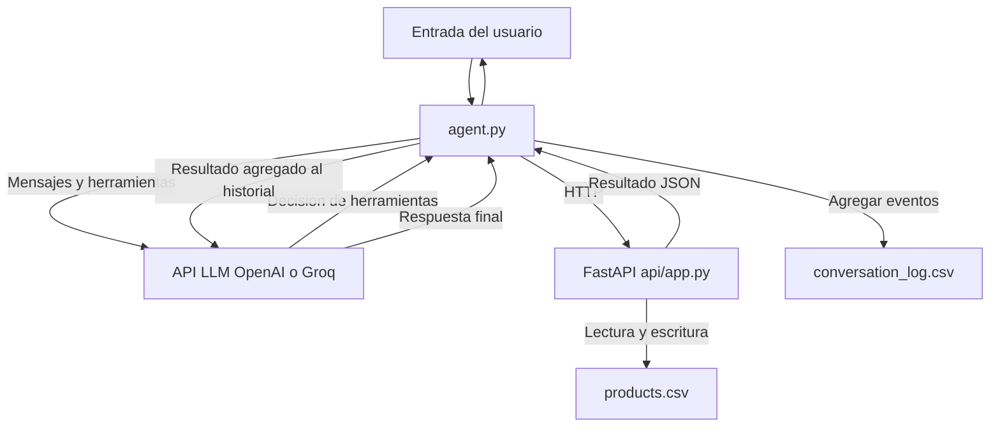

# AI Inventory Agent

Servicio de inventario FastAPI con persistencia CSV y agente Python con un bucle
manual Observe -> Think -> Act -> Update -> Repeat. No usa frameworks de agentes.

Implementa los requisitos de la
[solucion de referencia](https://github.com/4GeeksAcademy/ai-engineering-syllabus/blob/main/content/projects/ai-basic-inventory-agent-loop/.learn/solution/README.md).

## Instalacion

Requisitos: Python 3.10 o posterior, acceso a internet para instalar dependencias
y una clave OpenAI o Groq con acceso a un modelo que permita llamadas a herramientas.
Las llamadas reales al modelo pueden generar costes. Las pruebas no necesitan
credenciales ni realizan llamadas a proveedores LLM.

Desde la raiz del repositorio:

```bash
python -m venv .venv
source .venv/bin/activate
python -m pip install -r requirements.txt
cp .env.example .env
```

Editar `.env` localmente y completar `OPENAI_API_KEY`. No publicar esta clave.
`OPENAI_MODEL` usa `gpt-4o-mini` por defecto y `INVENTORY_API_URL` usa
`http://127.0.0.1:8000`. El archivo `.env` esta excluido de Git.

### Configuracion para Groq

El SDK OpenAI tambien funciona con la API compatible de Groq. Mantener los
nombres de las variables y configurar en `.env`:

```dotenv
OPENAI_API_KEY=tu_clave_de_groq
OPENAI_BASE_URL=https://api.groq.com/openai/v1
OPENAI_MODEL=tu_identificador_de_modelo_groq
INVENTORY_API_URL=http://127.0.0.1:8000
```

Usar el identificador exacto de un modelo disponible en la cuenta de Groq que
admita herramientas. Los valores `tu_clave_de_groq` y
`tu_identificador_de_modelo_groq` son marcadores, no valores reales. Una clave
Groq enviada al servidor OpenAI puede producir un error 401; cambiar solo el
modelo no cambia el servidor. Si persiste el 401 con la URL correcta, comprobar
que la clave Groq sea valida y no este revocada.

Reiniciar el agente despues de modificar `.env`: escribir `salir` y ejecutar
`.venv/bin/python agent.py` de nuevo. No hace falta reiniciar la API. Las
variables ya exportadas en la terminal tienen prioridad sobre `.env`.

## Arranque en dos terminales

Ejecutar ambos comandos desde la raiz del repositorio y mantener la API abierta
mientras se utiliza el agente.

Terminal 1, API:

```bash
source .venv/bin/activate
uvicorn api.app:app --host 127.0.0.1 --port 8000
```

API: http://127.0.0.1:8000/inventory.
Documentacion interactiva: http://127.0.0.1:8000/docs.
Usar un unico worker: el bloqueo CSV protege las operaciones dentro de un
proceso. Este servicio local no incorpora autenticacion y no debe exponerse
directamente a internet.

Terminal 2, agente:

```bash
source .venv/bin/activate
python agent.py
```

Escribir consultas o acciones en lenguaje natural. `salir`, `exit`, `quit`, EOF
o Ctrl+C terminan la sesion. El inventario inicial esta vacio; solicitar la
creacion de productos con nombre, cantidad y unidad antes de actualizar stock.

## Arquitectura



- Observe: recibe el mensaje y lo agrega al historial y al registro.
- Think: envia todo el historial y los cuatro esquemas tipados al modelo.
- Act: ejecuta por HTTP todas las llamadas solicitadas por el modelo.
- Update: agrega cada resultado con su `tool_call_id` al historial y al registro.
- Repeat: consulta de nuevo al modelo hasta una respuesta sin llamadas pendientes.

La API es la unica fuente de verdad del stock. El agente mantiene el historial
completo durante la sesion, pero no recupera conversaciones de sesiones previas.
Los errores de herramientas tambien se devuelven al modelo. Tras un fallo de red
no se reintenta automaticamente una mutacion, porque podria haberse aplicado.

## Contrato de la API

| Metodo | Ruta                      | Entrada                              | Respuesta                                   |
| ------ | ------------------------- | ------------------------------------ | ------------------------------------------- |
| GET    | `/inventory`              | Ninguna                              | 200, lista de productos                     |
| POST   | `/inventory`              | `name`, `quantity`, `unit`           | 201, producto creado                        |
| PATCH  | `/inventory/{product_id}` | `delta` entero con signo             | 200, producto actualizado                   |
| GET    | `/inventory/alerts`       | `threshold` opcional, por defecto 10 | 200, productos con cantidad menor al umbral |

Cada producto contiene `id`, `name`, `quantity` y `unit`. Los IDs se asignan
automaticamente. Las cantidades son enteros no negativos; los nombres y las
unidades no pueden estar vacios. Se admiten deltas positivos, negativos y cero.
Una cantidad exactamente igual al umbral no genera alerta.

Los errores incluyen `detail`: 404 para IDs inexistentes, 400 si un delta dejaria
stock negativo, 422 para entradas invalidas y 500 para un CSV corrupto. Los datos
invalidos no se aplican al inventario.

Ejemplos de llamadas directas:

```bash
curl -X POST http://127.0.0.1:8000/inventory \
	-H 'Content-Type: application/json' \
	-d '{"name":"oat milk","quantity":5,"unit":"units"}'

curl -X PATCH http://127.0.0.1:8000/inventory/1 \
	-H 'Content-Type: application/json' -d '{"delta":30}'

curl 'http://127.0.0.1:8000/inventory/alerts?threshold=10'
```

## Persistencia y registro

`products.csv` esta en la raiz del proyecto y contiene `id,name,quantity,unit`.
La API lo crea si falta y lee el estado persistido en cada operacion, tambien
despues de reiniciar. Las escrituras reemplazan el archivo de forma atomica.

`conversation_log.csv` contiene estas columnas, en este orden:

| Campo       | Contenido                                                                |
| ----------- | ------------------------------------------------------------------------ |
| `actor`     | `user`, `agent` o `tool`                                                 |
| `message`   | Mensaje del usuario, respuesta del agente o resultado JSON               |
| `tool_call` | Llamada serializada con ID, nombre y argumentos; vacio si no corresponde |
| `timestamp` | Fecha y hora UTC en ISO 8601                                             |

Cada llamada registra un evento `agent` con la solicitud y un evento `tool`
con el resultado. Tambien se registran la entrada del usuario y la respuesta
final. El archivo se abre exclusivamente para agregar eventos y conserva los
registros entre ejecuciones. CSV maneja comas, saltos de linea y comillas en los
mensajes. Los registros pueden contener informacion del usuario; revisarlos
antes de compartirlos. No ejecutar varios agentes escribiendo el mismo log
simultaneamente.

## Ejemplos de aceptacion

En un inventario vacio, crear primero mediante el agente:

```text
Crea oat milk con 5 units y arabica con 20 bags.
```

Luego:

```text
we just received 30 units of oat milk
we sold 12 bags of arabica today
what products are running low?
```

Resultados esperados: oat milk pasa de 5 a 35; arabica pasa de 20 a 8;
las alertas devuelven solo arabica, con cantidad 8. El agente consulta IDs reales
antes de aplicar los deltas y registra las llamadas, resultados y respuestas.
La redaccion y las decisiones del modelo no son deterministas; el agente nunca
debe afirmar una actualizacion que la API no haya confirmado.

## Verificacion

```bash
source .venv/bin/activate
python -m pytest tests -q
```

Las pruebas verifican los cuatro endpoints, persistencia entre reinicios, IDs,
deltas con signo, limites de alertas, validacion y errores. Para el agente usan
respuestas simuladas del modelo y del transporte HTTP para verificar llamadas
multiples, historial completo, reinyeccion, esquemas, errores y registros
acumulativos con marcas de tiempo. No sustituyen una prueba con credenciales
reales y el modelo elegido.

## Checklist de entrega

- [x] `api/app.py` expone los cuatro endpoints y devuelve respuestas validas.
- [x] `products.csv` conserva el inventario entre reinicios de la API.
- [x] `agent.py` ejecuta el ciclo manual completo y multiples llamadas.
- [x] Las cuatro herramientas tienen esquemas explicitos y tipados.
- [x] El agente reutiliza todo el historial dentro de cada sesion.
- [x] Los resultados de herramientas se incorporan antes de la siguiente iteracion.
- [x] Una respuesta sin llamadas pendientes termina el turno.
- [x] El agente ofrece entrada y salida por terminal.
- [x] `conversation_log.csv` registra usuarios, llamadas, resultados y respuestas.
- [x] El registro incluye los cuatro campos requeridos y es acumulativo entre ejecuciones.
- [x] No se utiliza ningun framework de agentes.
- [x] Este README explica el arranque de API y agente en dos terminales.
